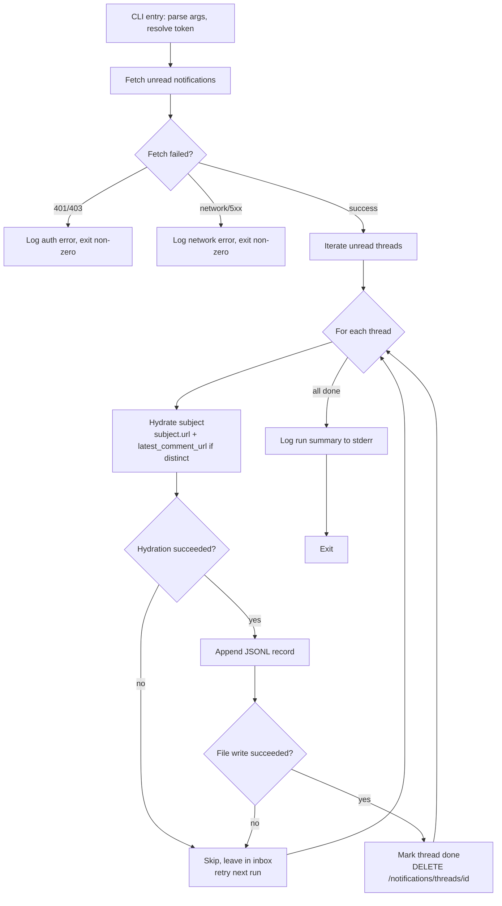

# feat: GitHub Notifications Feed CLI

## Summary

A TypeScript/Node CLI that polls your GitHub notifications, hydrates each one's subject content (container + triggering comment), appends each as a self-contained JSONL record to a local feed file, and marks the thread done on GitHub only after the file write succeeds. Discussion and ci_activity notifications are captured as envelope-only in v1 (REST hydration unavailable or undocumented for those types).

## Problem Frame

GitHub's Notifications API surfaces events an LLM could react to — mentions, assigns, review requests, CI runs — but the notification envelope carries only a title and URLs, not the content the LLM needs. The inbox also doesn't persist; it has to be drained into a durable, self-contained file that a downstream pipeline can read without making its own round of GitHub calls. The brainstorm scoped this as a one-way capture tool that owns the inbox and produces that feed file.

## Requirements

- R1. On each invocation, the tool fetches unread notifications covering both personal interactions and watched-repo activity.
- R2. For each new notification, the tool fetches the subject content so the captured record is self-contained.
- R3. Each captured notification is appended to the local feed file with its envelope and hydrated content.
- R4. A notification is marked done on GitHub only after both the file write and content hydration have succeeded.
- R5. On the next invocation, the tool does not re-capture notifications already marked done.
- R6. If content hydration fails for a notification, the tool does not mark that thread done; it retries on the next invocation.
- R7. If the file write fails for a notification, the tool does not mark that thread done; same retry behavior as R6.
- R8. A failure on one notification does not abort capture of the remaining notifications in the same invocation.
- R9. The feed file is append-only — existing records are never rewritten or deleted by the tool.
- R10. Each record is independently parseable (no cross-record state required to read one entry).
- R11. The tool authenticates via a personal access token (classic) with the `notifications` scope, `repo` for private-repo hydration, and `security_events` for Dependabot-alert hydration on private repos.
- R12. The token is read from an explicit source, never committed to the repo.

## Key Technical Decisions

**Runtime: TypeScript on Node.js.** Chosen over Python/Go/Shell for ecosystem fit with Octokit and JSONL handling. Node's native `fetch` covers HTTP; the language maps cleanly to the JSON-shaped domain.

**HTTP client: the `octokit` umbrella package (v5.x).** Bundles `@octokit/rest`, `@octokit/auth-token` (default authStrategy for PATs), `@octokit/plugin-paginate-rest`, `@octokit/plugin-retry`, and `@octokit/plugin-throttling`. All three — pagination, retry on 5xx, secondary-rate-limit handling — are enabled by default. This removes a category of failure handling we'd otherwise write by hand. Construction from a PAT is a one-liner.

**Feed file format: JSONL (one JSON object per line).** Append-only semantics map directly to `fs.appendFile` writes. Each line is independently parseable, satisfying R10. No need to read or rewrite the file on capture. This was the user-facing fork in the synthesis; it is settled here.

**Hydration strategy: fetch both `subject.url` and `subject.latest_comment_url` when distinct.** Research confirmed `subject.url` returns the container (issue/PR body), while `latest_comment_url` returns the triggering comment — both are needed to satisfy the comment-on-PR acceptance case (AE4). When the two URLs are equal, fetch only once.

**Per-type hydration dispatch by `subject.type`.** Issue, PullRequest, Commit, Release, and RepositoryVulnerabilityAlert hydrate via their documented REST endpoints; the URL is fetched directly (do not reconstruct URLs from type, per GitHub's hypermedia guidance). Discussion and CheckSuite/WorkflowRun fall back to envelope-only records in v1 — Discussions are GraphQL-only (verified: no REST API), and ci_activity subject hydration is undocumented. The dispatch is a table keyed on type, not a switch statement hard-coded per branch, so adding a hydrated type in v2 is a one-line addition.

**Ordering invariant: hydrate → write file → mark done, per notification.** The brainstorm's R4/R6/R7 requirements make the per-notification ordering load-bearing. A failed hydration or write leaves the thread in the inbox; mark-done only fires after both succeed. This natural-retry behavior is the safety property.

**Auth source: environment variable (`GH_NOTIFICATIONS_TOKEN`), overridable via `--token-file` flag.** Environment variables are the standard Node convention. A `--token-file <path>` flag exists for cases where the caller wants explicit control without exposing the token in argv or shell history (a `--token` flag would leak the PAT via `ps`, shell history, and crash dumps). The tool refuses to run without a token. `.gitignore` excludes `.env` from the repo.

**No conditional-request optimization in v1.** The 5000/hr PAT budget with manual invocation is more than sufficient — empty polls are cheap. Conditional requests were considered and rejected for v1 because: (1) a 304 short-circuit would strand any thread whose hydration failed on a previous run (violating R6 — the inbox is unchanged, so every subsequent poll returns 304 and the failed thread never retries), and (2) mark-done mutations invalidate the `Last-Modified` cursor anyway, making the optimization largely inoperative after any productive run. ETag/If-Modified-Since support is deferred to a future version that can solve the retry-liveness problem.

**File permissions: feed file created `0o600`.** The feed file stores private-repo content and Dependabot alerts — owner-only read/write. The sidecar state file (if added in a future version) uses the same mode.

**Log redaction: structured logs sanitize auth and URL fields.** Octokit error objects carry request headers (including the Authorization header). The logging layer redacts `*.headers.authorization`, `*.token`, and any Octokit error's `request` field before writing to stderr. A test asserts the PAT string never appears in stderr output.

---

## Output Structure

```text
.
├── package.json
├── tsconfig.json
├── .gitignore
├── README.md
├── src/
│   ├── index.ts                  # CLI entry point: arg parsing, orchestration
│   ├── config.ts                 # Token resolution, output path, defaults
│   ├── github-client.ts          # Octokit construction, pagination wrapper
│   ├── hydrate.ts                # Per-type hydration dispatch
│   ├── feed-file.ts              # Append-only JSONL writes (0o600 permissions)
│   ├── capture.ts                # Per-thread orchestration loop
│   └── types.ts                  # Feed record shape, notification types
└── tests/
    ├── hydrate.test.ts           # Per-type dispatch + fallback behavior
    ├── feed-file.test.ts         # Append semantics, record independence, permissions
    └── ordering.test.ts          # Failure-isolation invariants (R4/R6/R7/R8)
```

New project, no existing files touched. The directory layout groups by concern (CLI, GitHub I/O, hydration, persistence) rather than layering.

---

## High-Level Technical Design

### Per-invocation flow



The ordering-invariant enforcement (hydrate → write → mark-done, per thread) is visible in the G→H→I→J→K sequence. SKIP preserves the thread in the inbox because mark-done never fired. The primary-fetch error branch (BERR) exits the entire run before iteration begins — per-thread isolation (R8) applies only within the loop, not to the fetch step.

### Hydration dispatch by subject type

| `subject.type` | Hydration target | v1 behavior |
|---|---|---|
| `Issue` | `subject.url` → issue body; `latest_comment_url` → triggering comment (if distinct URL) | Full hydration |
| `PullRequest` | `subject.url` → PR body; `latest_comment_url` → triggering comment (if distinct) | Full hydration |
| `Commit` | `subject.url` → commit message + metadata | Full hydration |
| `Release` | `subject.url` → release notes body | Full hydration |
| `RepositoryVulnerabilityAlert` | `subject.url` → Dependabot alert details | Full hydration (requires `security_events` scope for private repos) |
| `Discussion` | None (GraphQL-only; out of REST scope) | Envelope-only fallback |
| `CheckSuite` / `WorkflowRun` | None (subject URL undocumented by GitHub) | Envelope-only fallback |
| Unknown types | None | Envelope-only fallback |

The dispatch is a lookup table keyed on `subject.type`, not a hard-coded switch. Adding a hydrated type is a one-entry addition.

---

## Implementation Units

### U1. Project scaffold and CLI entry point

- **Goal:** Establish the TypeScript/Node project structure and the CLI's argument-parsing + token-resolution entry point.
- **Requirements:** R11, R12.
- **Dependencies:** None (first unit).
- **Files:**
  - `package.json` — dependencies (`octokit`, `commander` for arg parsing, `pino` for structured logging); dev dependencies (`typescript`, `tsx` for dev runs, `vitest`, `@types/node`); scripts (`dev`, `build`, `test`, `typecheck`).
  - `tsconfig.json` — `module: "node16"`, `moduleResolution: "node16"` (required by octokit v5), `strict: true`, `outDir: "./dist"`.
  - `.gitignore` — excludes `node_modules/`, `dist/`, `.env`, and the feed output file (`notifications.jsonl`).
  - `src/index.ts` — CLI entry: parse args with `commander`, resolve token, wire to orchestration (which is fleshed out in later units; for now it exits with a "not yet wired" message once args parse).
  - `src/config.ts` — token resolution from `--token-file` flag (reads the file) or `GH_NOTIFICATIONS_TOKEN` env var; output file path resolution (default `./notifications.jsonl`).
  - `src/types.ts` — TypeScript types for the notification thread, subject, and the feed record shape.
- **Approach:** `commander` for the CLI surface (`--token-file`, `--output`, `--verbose`). Config resolution fails fast with a clear error if no token is found. The feed record shape is defined here so all units share it: `{ id, captured_at, reason, subject_type, title, repository: {full_name, html_url}, subject_url, latest_comment_url, subject_content, latest_comment_content, hydrated }`. Structured logging via `pino` (JSON to stderr) with redaction paths for `*.headers.authorization`, `*.token`, and Octokit error `request` fields — the PAT must never appear in logs.
- **Patterns to follow:** Standard Node CLI conventions; structured logging via `pino` (JSON to stderr) so the feed file stays clean on stdout.
- **Test scenarios:**
  - Token resolution reads the token from `--token-file` when the flag is provided.
  - Token resolution falls back to `GH_NOTIFICATIONS_TOKEN` env var when no flag.
  - Token resolution throws a clear error when neither is present.
  - `--token-file` pointing to a missing file throws a clear error.
  - Output path resolves to the flag value when provided, else default.
- **Verification:** `npm run build` compiles; `npm run typecheck` passes; `node dist/index.js --help` prints usage with all flags documented.

### U2. GitHub client and notification fetch

- **Goal:** Construct the authenticated Octokit instance and fetch the user's unread notifications.
- **Requirements:** R1, R5 (via mark-done's effect — unread notifications are the unprocessed set).
- **Dependencies:** U1.
- **Files:**
  - `src/github-client.ts` — Octokit construction (`new Octokit({ auth, throttle: { onRateLimit, onSecondaryRateLimit } })`), a `fetchNotifications()` function using `octokit.paginate("GET /notifications", { per_page: 50 })`, and a `markThreadDone(threadId)` function (`DELETE /notifications/threads/{thread_id}`).
  - `tests/github-client.test.ts` — fetch behavior, pagination, error handling.
- **Approach:** The fetch uses `octokit.paginate()` to gather all unread threads across pages. No conditional-request headers in v1 (dropped per KTD — see rationale there). The `X-Poll-Interval` header is logged on each response; if GitHub returns 403 with a `Retry-After` header (polled too frequently), the error is surfaced clearly — the tool does not auto-retry poll-interval violations, it exits with a message telling the operator to wait. Octokit's throttling plugin handles secondary rate limits with one retry and a 60s fallback.
- **Technical design:** Pseudo-code for the fetch:
  ```
  threads = await octokit.paginate("GET /notifications", { per_page: 50 })
  return threads.filter(t => t.unread === true)
  ```
  The fetch throws on 401 (invalid/expired token), 403 (wrong scope or poll-interval violation), or network errors — these propagate to the caller (U5) which handles them as a top-level failure (exit non-zero, no per-thread processing).
- **Patterns to follow:** Octokit's standard `paginate` pattern from its README.
- **Test scenarios:**
  - Happy path: `fetchNotifications` returns all unread threads.
  - Pagination: when the inbox has 60 unread notifications, `fetchNotifications` returns all 60 (not just the first 50).
  - `markThreadDone` calls DELETE with the correct thread ID.
  - Fetch with 401 (invalid token): throws a clear auth error.
  - Fetch with 403 (wrong scope): throws a clear scope error.
  - Fetch with network error: throws a clear network error.
  - Empty inbox: returns an empty array without error.
- **Verification:** `npm run typecheck` passes; unit tests pass; manual run against a real PAT (with the operator's own GitHub) prints the notification list without error.

### U3. Subject hydration dispatch

- **Goal:** Fetch the content behind a notification's `subject.url` and `latest_comment_url`, dispatching by subject type.
- **Requirements:** R2, R8 (partial — failures in hydration are caught here).
- **Dependencies:** U2.
- **Files:**
  - `src/hydrate.ts` — `hydrateSubject(thread, octokit)` function. Dispatch table keyed on `subject.type`. For hydrated types (Issue, PullRequest, Commit, Release, RepositoryVulnerabilityAlert): fetch `subject.url`; if `latest_comment_url` differs from `subject.url`, fetch that too. For fallback types (Discussion, CheckSuite, WorkflowRun, unknown): return envelope-only without fetching.
  - `tests/hydrate.test.ts` — per-type dispatch and fallback.
- **Approach:** The dispatch table maps each known type to a hydration function. All hydrated types share the same fetch pattern (GET the URL, extract body/title/content from the response); the per-type variation is minimal, so a single generic fetcher parameterized by the response-content extraction field covers most cases. Failures (network, 404, 403) throw and are caught by the caller (U4's orchestration), which skips the thread without marking done. The `hydrated: boolean` field on the returned record signals whether content was fetched.
- **Patterns to follow:** GitHub's hypermedia guidance: fetch the URL as given, do not reconstruct URLs from type + parsed components.
- **Test scenarios:**
  - Issue with distinct `latest_comment_url`: returns issue body + comment text, `hydrated: true`.
  - Issue where `subject.url === latest_comment_url`: fetches once, returns issue body only, `hydrated: true`.
  - PullRequest: same patterns as Issue.
  - Commit: returns commit message and metadata, `hydrated: true`.
  - Release: returns release notes body, `hydrated: true`.
  - Discussion: returns envelope-only (no fetch attempted), `hydrated: false`.
  - Unknown type (e.g., `SomeNewType`): returns envelope-only, `hydrated: false`.
  - Hydration fetch returns 404 (deleted subject): throws, caught by caller; thread skipped.
  - `latest_comment_url` is null or empty: fetches `subject.url` only.
- **Verification:** Unit tests pass with mocked Octokit responses; manual run against a real mention notification captures the issue/PR body.

### U4. Feed file writer

- **Goal:** Append each captured notification as a self-contained JSONL record to the feed file.
- **Requirements:** R3, R9, R10.
- **Dependencies:** U1 (types, config).
- **Files:**
  - `src/feed-file.ts` — `appendRecord(outputPath, record)` function. Uses `fs.promises.appendFile` with a single `JSON.stringify(record) + "\n"` write. Creates the file with `mode: 0o600` (owner read/write only) — the file stores private-repo content and Dependabot alerts.
  - `tests/feed-file.test.ts` — append semantics, record independence, permissions.
- **Approach:** Append-only is the natural fit for JSONL: each `appendFile` call adds one line, no read-modify-write. On first creation, the file is opened with `0o600`; subsequent appends preserve the existing mode. A crash mid-write can leave a partial trailing line — downstream consumers must skip a trailing line that doesn't end with a newline delimiter (this is the standard JSONL recovery rule; documented in the README). The thread isn't marked done on crash, so the next run re-captures it as a new complete line after the partial one. Record independence (R10) holds for all complete lines.
- **Patterns to follow:** Standard Node `fs.promises.appendFile` with `flag: "a"` (the default for appendFile).
- **Test scenarios:**
  - Append to a non-existent file: file is created with one line, permissions `0o600`.
  - Append to an existing file: line is added to the end, existing lines untouched.
  - Record independence: write 3 records, then read the file line-by-line; each line parses as independent JSON without needing siblings.
  - Unicode/special characters in content: round-trip preserves them.
  - Large content (10KB body): written correctly on one line.
  - File permissions: created file has mode `0o600`, not the default `0o644`.
- **Verification:** Unit tests pass; a temp-dir run produces a valid JSONL file readable by `jq` line-by-line with `0o600` permissions.

### U5. Capture orchestration with failure isolation

- **Goal:** Wire fetch → hydrate → write → mark-done per notification, with the ordering invariants enforced and top-level fetch errors handled.
- **Requirements:** R4, R6, R7, R8.
- **Dependencies:** U2 (fetch, mark-done), U3 (hydrate), U4 (write).
- **Files:**
  - `src/capture.ts` — the orchestration loop. Called from `src/index.ts` after CLI arg parsing.
  - `tests/ordering.test.ts` — failure-isolation invariants.
- **Approach:** The per-thread loop enforces the ordering invariant: hydrate, then write, then mark-done, with any failure skipping mark-done. Failures are caught per-thread so one bad notification doesn't abort the batch (R8). The top-level fetch is outside the per-thread loop — a fetch failure (401, 403, network) exits the entire run non-zero before any threads are processed. A structured run summary is logged to stderr at the end: captured N, skipped K (with reasons), failed F.
- **Technical design:** Pseudo-code for the orchestration:
  ```
  // Top-level fetch — errors abort the entire run
  try:
    threads = await fetchNotifications()
  catch err:
    log.error("fetch failed", redact(err))
    process.exit(1)

  for each thread in threads:
    try:
      content = await hydrateSubject(thread)
    catch:
      skipped++; continue  // R6: no mark-done
    // Build the curated record shape explicitly — do not spread the raw thread
    record = {
      id: thread.id,
      captured_at: new Date().toISOString(),
      reason: thread.reason,
      subject_type: thread.subject.type,
      title: thread.subject.title,
      repository: { full_name, html_url } from thread.repository,
      subject_url: thread.subject.url,
      latest_comment_url: thread.subject.latest_comment_url,
      subject_content: content.subject_body,
      latest_comment_content: content.comment_body,
      hydrated: content.hydrated
    }
    try:
      await appendRecord(output, record)
    catch:
      skipped++; continue  // R7: no mark-done
    try:
      await markThreadDone(thread.id)
    catch:
      logged++; // record is in the file but thread stays in inbox
                 // next run re-captures as duplicate — consumers MUST dedup on id
  log.summary({ captured, skipped, failed })
  ```
- **Patterns to follow:** Per-item try/catch with continue, not a transaction-style rollback (each notification is independent).
- **Test scenarios:**
  - Happy path: 3 new threads, all hydrate and write succeed, all 3 marked done, 3 records in file.
  - Hydration failure on middle thread (Covers R8): threads 1 and 3 captured and marked done; thread 2 skipped, not marked done, no record written for it.
  - File write failure on middle thread (Covers R6, R7): thread 2's mark-done skipped; thread 2 remains in inbox.
  - Mark-done failure: record is in the file; thread stays in inbox; logged as "will re-capture next run" (duplicate on next run — consumers must dedup on `id`).
  - Top-level fetch failure (401): exits non-zero, zero threads processed, no file writes.
  - Top-level fetch failure (network): exits non-zero, zero threads processed.
  - Run summary: captured/skipped/failed counts match actual outcomes.
  - Empty inbox: fetch succeeds, returns empty array, exits cleanly with "0 new notifications".
- **Verification:** Unit tests pass with mocked sub-steps; manual end-to-end run against a real GitHub account with a seeded notification produces a valid feed file and clears the inbox.

### U6. README and operator documentation

- **Goal:** Document the tool's usage, configuration, failure modes, and the feed-file contract for downstream consumers.
- **Requirements:** Supports all requirements via documentation.
- **Dependencies:** U1–U5 (all units must be finalized).
- **Files:**
  - `README.md` — usage, installation, configuration (token setup, scopes), flags, output format, and the consumer contract.
- **Approach:** The README is the primary documentation surface. It covers: token setup (env var vs `--token-file`), required PAT scopes (`notifications` + `repo` + `security_events`), invocation (`npx tsx src/index.ts` for dev, `node dist/index.js` for built), the feed file format (JSONL, one record per line), the consumer contract (downstream pipelines MUST dedup on `id` — mark-done failures can produce duplicates), the partial-line recovery rule (skip a trailing line without a newline terminator), and the operator's retention responsibility (the tool never deletes or rotates the feed file).
- **Test expectation:** none — documentation unit.
- **Verification:** README accurately reflects all flags, defaults, and behaviors implemented in U1–U5.

---

## Scope Boundaries

### Out of scope (per brainstorm)

- Actions back to GitHub beyond mark-done (commenting, closing, assigning, merging). The LLM reaction pipeline is separate.
- Capture of all repo activity independent of subscription state (Events API / webhooks firehose).
- Real-time push delivery (webhooks). Capture is poll-on-invoke only.
- Background scheduling (cron, launchd, daemon). Invocation is manual.

### Deferred to Follow-Up Work

- GraphQL hydration for Discussion notifications (v1 captures envelope-only; v2 adds GraphQL queries for full discussion content). A GraphQL-based capture path for all notification types could also collapse the N+1 REST hydration fan-out into fewer round-trips — worth evaluating before adding more REST hydration types.
- CI activity hydration (CheckSuite/WorkflowRun) — blocked on GitHub documenting the subject URL for these types, or on reverse-engineering the mapping.
- Conditional-request optimization (`If-Modified-Since` / ETag) — dropped from v1 because the 304 short-circuit strands failed-thread retries (R6 violation) and mark-done mutations invalidate the cursor. A future version could solve retry-liveness (e.g., track failed thread IDs in a sidecar, force non-conditional fetch when any exist) and re-enable the optimization.
- Built-in dedup for the mark-done-failed edge case. In v1, consumers MUST dedup on the `id` field (documented in the README). A future version could read existing captured IDs before appending to prevent duplicates at write time.
- Feed file retention management. The tool never deletes or rotates the feed file; the operator owns pruning and archival.

---

## Risks & Dependencies

- **Octokit v5 requires Node 16+ `moduleResolution: "node16"`.** The tsconfig must set this or imports fail. Verified in Octokit's README.
- **GitHub does not publish an official mapping from `subject.type` to the REST endpoint `subject.url` resolves to.** The per-type hydration table is based on community-documented behavior + the documented endpoints, not an official spec. If GitHub changes a subject URL shape, the type's hydration breaks and falls back to throwing (caught, thread skipped, retried). Mitigation: fetch URLs as given rather than reconstructing them.
- **`latest_comment_url` semantics are not officially documented per-type.** The tool assumes it points to the triggering comment when distinct from `subject.url`. If this assumption breaks for some type, the captured record still has the container body; the comment fetch just returns unexpected content. Low impact.
- **Secondary rate limits can hit without proactive warning.** Octokit's throttling plugin handles one retry with a 60s fallback; beyond that, a run may fail mid-batch. Mitigation: per-thread failure isolation means partial progress is preserved (captured threads are done; the rest retry next run).
- **Mark-done failure leaves duplicates.** If `DELETE` fails after the file write, the thread stays in the inbox and re-captures on the next run. Consumers MUST dedup on the `id` field (documented in the README). Built-in write-time dedup is deferred.
- **Poll-interval 403 aborts the entire run.** If invoked more frequently than `X-Poll-Interval` permits, GitHub returns 403 with `Retry-After`. This hits the top-level fetch (not per-thread), so the whole run aborts. Mitigation: the error message tells the operator to wait; the tool does not auto-retry poll-interval violations.

---

## Open Questions

- **Exact log verbosity default.** U1 wires structured JSON logging to stderr; whether the default level should be `info` (run summaries) or `warn` (only failures) is a UX decision deferred to implementation. Flag `--verbose` exposes debug.
- **Whether to ship a `--dry-run` flag** that hydrates and logs without writing the file or marking done. Useful for first-run validation; deferred unless quick to add at U5.

---

## Sources & Research

- GitHub REST API: Notifications — `https://docs.github.com/en/rest/activity/notifications` (schema, mark-done endpoints, `X-Poll-Interval`, conditional-request behavior, PAT-only auth requirement).
- GitHub REST API: Rate limits — `https://docs.github.com/en/rest/using-the-rest-api/rate-limits-for-the-rest-api` (5000/hr PAT primary limit, secondary rate limits, conditional requests don't cost primary budget).
- GitHub REST API: Best practices — `https://docs.github.com/en/rest/guides/best-practices-for-using-the-rest-api` ("do not manually parse URLs" guidance informs the fetch-as-given approach).
- Octokit umbrella package — `https://github.com/octokit/octokit.js` (v5.x; bundles auth-token, paginate-rest, retry, throttling; `moduleResolution: "node16"` requirement).
- `@octokit/plugin-throttling` — `https://github.com/octokit/plugin-throttling.js` (secondary rate limit handling, `onRateLimit` / `onSecondaryRateLimit` callbacks).
- Discussions: GraphQL API guide exists, REST guide returns 404 — `https://docs.github.com/en/graphql/guides/using-the-graphql-api-for-discussions` (informs envelope-only fallback for Discussion notifications).
- Origin: `docs/brainstorms/2026-06-24-github-notifications-feed-requirements.md`.
